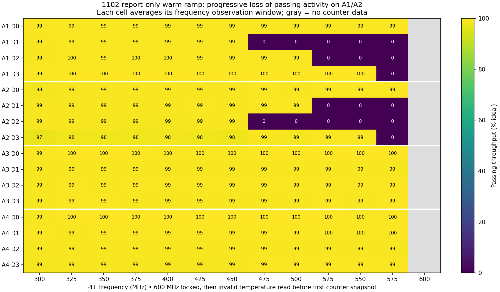

# 1102 warm 300→600 MHz, voltage and throughput report-only

2026-09-04. User requested removing the guards and running 1102 to 600 MHz while retaining the 300 MHz warmup.

**All four PLLs locked at 600 MHz, but sustained 600 MHz operation was not demonstrated.** The first temperature read after launch returned −288.90°C for A3. The retained sensor-integrity check powered off before the planned 120-second hold. There is no 600 MHz counter sample or measured 600 MHz throughput.

## Configuration and procedure

- Board 1102, IP `192.168.30.193`, MAC `10:B4:1D:D5:CA:14`, serial `/dev/cu.usbmodem11434401`. User confirmed both scope connections had moved to this board.
- TPS readbacks: 1300 kHz, scale 0.125, compensation `13 20 C6 19 C6`, ON_OFF_CONFIG `0x1F`. GPIO10 enable supported; no midpoint ADC on 1102.
- Temporary 1140 mV per half-stack. Saved settings remain 600 MHz / 1160 mV, minimum fan 25%, automatic fan, target 60°C.
- Temporary fan starts at 20% during warmup. First 300 MHz domain samples were approximately 33°C; warm gate reached at boot time 333.170 seconds. Warm baseline qualification passed at 99.20%, 1485.68 / 1497.60 GH/s.
- Broadcast PLL/work launch sequence retained; 25 MHz steps from 300 to 600, scope handshake at each step. Approximately ten seconds observation after scope download at intermediate frequencies; planned fixed-PLL/work 120 seconds at 600.
- Firmware voltage and throughput thresholds and host scope voltage limits were report-only. Weak steps continued without the guarded mode's recovery hold. Temperature/sensor validity, communication failures, scope acquisition integrity/clipping, manual stop, fan control and configured TPS hardware protections remained active.
- Bench report-only behavior requires both compile-time probe flags and actual/target board 1102. Other boards and normal firmware retain their prior checks.

## Domain progression

All 16 domains remained productive through 450 MHz. At 475 MHz A1 D1 and A2 D2 had all 39 cores at zero PASS. By 525 MHz D1 and D2 were at zero PASS on both A1/A2; at 575 MHz D3 also failed on each. A3/A4 remained near 99% throughput. Failed domains continued recording FAIL activity; zero PASS does not establish stopped clocks or a dead ASIC.

Rates below are derived from qualification-work PASS counter intervals over each recorded phase, not pool hashrate. The 300 MHz row includes the warmup; the separate warm baseline qualification is reported above.

| MHz | Estimated TH/s | Domains with all 39 cores at zero PASS |
|---:|---:|---|
| 300 | 1.482 | None |
| 325 | 1.610 | None |
| 350 | 1.734 | None |
| 375 | 1.857 | None |
| 400 | 1.980 | None |
| 425 | 2.104 | None |
| 450 | 2.227 | None |
| 475 | 2.062 | A1D1, A2D2 |
| 500 | 2.169 | A1D1, A2D2 |
| 525 | 1.955 | A1D1, A1D2, A2D1, A2D2 |
| 550 | 2.047 | A1D1, A1D2, A2D1, A2D2 |
| 575 | 1.783 | A1D1, A1D2, A1D3, A2D1, A2D2, A2D3 |
| 600 | Unavailable | No counter sample before sensor stop |

No failed domain regained PASS activity in subsequent recorded steps through 575 MHz. Each frequency step includes another PLL/work launch, so this was not a fixed-PLL passive recovery experiment. At 575 MHz A1/A2 D2 measured about 247 mV, versus about 305–307 mV for A3/A4. Last valid A3/A4 temperatures were 59.95°C, A1 58.80°C, A2 57.48°C.

## Why the run stopped

At boot time 562.944 seconds all four PLLs reported lock at 600 MHz; LAUNCHED was logged at 563.120. At 563.597 A3 temperature was −288.90°C, GPIO went low at 563.598, and the run ended at 563.606 with ASIC power OFF. The final hold was never entered. This is an invalid sensor result, not evidence that A3 physically cooled or overheated. The raw sensor code was not logged, so the cause is unresolved. Voltage and throughput thresholds did not cause the stop.

The 600 MHz scope audit has `accepted: false` because the run had already ended; `voltage_limits_enforced: false` remains recorded. Scope acquisition captured the approximately 212 ms launch and had no clipped samples. TPS undervoltage/PGOOD messages after intentional power-off should not be interpreted as the initiating fault.

## Scope measurements

CH1 was directly across TPS output caps, **50 Ω throughout**, DC, 1×, 20 MHz bandwidth, 0.2 V/div. CH2 was GND0−GND, 1 MΩ, DC, 1×, 20 MHz bandwidth. CH2 was widened to 0.5 V/div to capture unrestricted transients; its approximately 20 mV sample quantization is coarser than the previous run's 4 mV. Captures contain 700,000 samples per channel at 2 MSa/s, spanning −75 to +275 ms. All captures had zero clipped samples.

Lower means CH2; upper estimate means simultaneous CH1−CH2. The two probes are at different physical locations, so distribution and ground effects can contribute to the upper estimate. These are PCB half-stack voltages, not measurements across individual internal ASIC domains. Mean peaks use a sliding 20 µs window.

| Transition to MHz | Lower raw V | Lower mean V | Upper estimate raw V | Upper estimate mean V | TPS raw max V |
|---:|---:|---:|---:|---:|---:|
| 325 | 1.660 | 1.6100 | 1.400 | 1.2900 | 2.432 |
| 350 | 1.680 | 1.6155 | 1.388 | 1.2800 | 2.440 |
| 375 | 1.680 | 1.6245 | 1.400 | 1.2767 | 2.456 |
| 400 | 1.700 | 1.6335 | 1.400 | 1.2767 | 2.464 |
| 425 | 1.700 | 1.6415 | 1.400 | 1.2705 | 2.480 |
| 450 | 1.720 | 1.6580 | 1.392 | 1.2575 | 2.488 |
| 475 | 1.740 | 1.6675 | 1.400 | 1.2627 | 2.504 |
| 500 | 1.760 | 1.6845 | 1.412 | 1.2545 | 2.520 |
| 525 | 1.780 | 1.7030 | 1.408 | 1.2524 | 2.528 |
| 550 | 1.800 | 1.7310 | 1.372 | 1.2143 | 2.552 |
| 575 | 1.820 | 1.7380 | 1.392 | 1.2386 | 2.560 |
| 600 | 1.840 | 1.7570 | 1.400 | 1.2493 | 2.576 |

The 20 ms firmware rail sampler reported a maximum total of only 2275 mV and missed these fast peaks. Raw/mean thresholds of 1.25/1.22 V were recorded but not enforced.

## Interpretation and limits

Warmup alone did not prevent progressive A1/A2 failures in this run at temporary 1140 mV with this broadcast qualification-work sequence. This does not establish that old 1102 firmware cannot reach 600 MHz: the user's successful warm restart used a different startup sequence and saved 1160 mV. It also does not isolate PLL changes from work/configuration strobes or prove the measured transient caused each internal-domain failure.

The next unresolved issues are the invalid temperature response at 600 MHz and whether a failed domain can recover during a fixed-frequency hold or after a delayed work-only reset. This run provides no 600 MHz recovery observation.

## Validation, artifacts and final state

Probe and normal firmware builds succeeded. App-only flash completed with esptool hash verification. Host tests exercised actual board/rail helpers and capture-policy functions: report-only is restricted to the enabled 1102 warm probe; invalid/missing telemetry and GPIO/PMBus failures still propagate; a historical overvoltage capture proceeds while a clipped capture still stops.

ASIC power is OFF; final TPS telemetry 44 mV, fan 70% / 2754 RPM, scope STOP, CH1 50 Ω and CH2 1 MΩ. **The report-only probe image remains installed and reruns on reset.** Working source flags `PROTO_RUN_WARM_RAMP_PROBE` and `PROTO_WARM_REPORT_ONLY` are restored to zero. `normal.bin` was built but not flashed.

- `probe.bin`, `asic-init-source.c`: exact flashed test image and source snapshot.
- `normal.bin`, `asic-init-normal-source.c`: normal build, probe disabled.
- `build-probe.log`, `build-normal.log`, `flash.log`, `test-board.log`, `test-capture.log`: validation.
- `serial.log`, `capture.log`, `evidence.txt`: runtime evidence.
- `domain-samples.csv/json`, `rate-windows.json`, `frequency-summary.json`, `first-zero-domains.json`: counter and sensor analysis.
- `warm-baseline300/`, `step-325/` through `step-600/`: raw NPZ waveforms, preambles, audit metadata, statistics, plots.
- `scope-summary.json`, `domain-progression.png/pdf`, `ramp-summary.png/pdf`, `warmup-timeline.png/pdf`: summaries.
- `sha256.json`: artifact hashes; previous firmware backup remains in `../2026-09-04-1102-warm-ramp/previous-factory.bin`.
