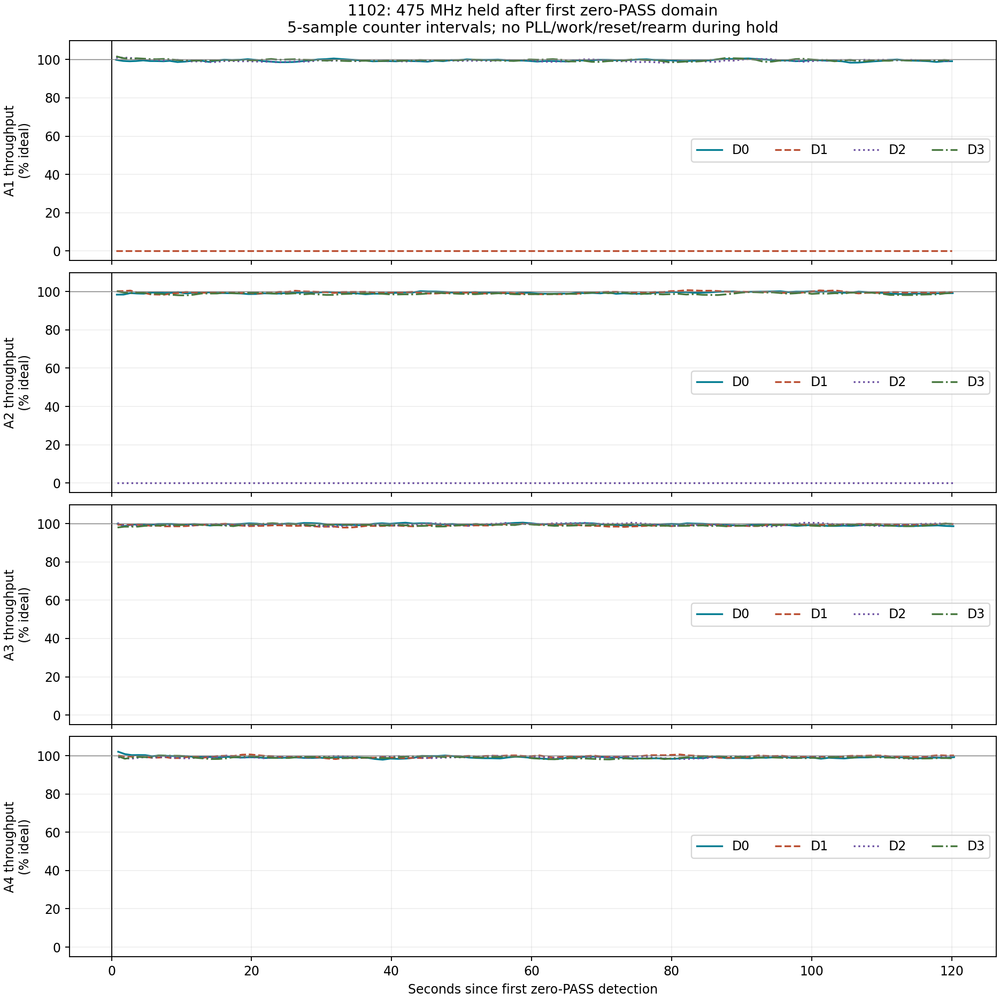
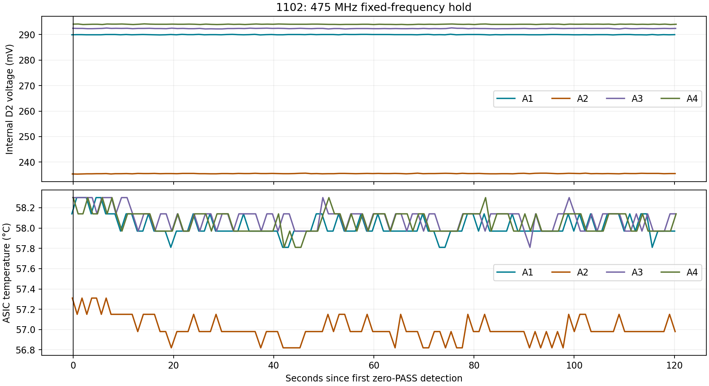

# 1102: passive hold after first zero-PASS domain

2026-09-04. Completed.

**No passive recovery occurred.** The same two domains failed at 475 MHz: A1 D1 and A2 D2. All 39 cores in each remained at zero PASS throughout a **120.930-second hold** with fixed PLL, work configuration and voltage, and no counter rearm. Their FAIL counters continued increasing. The other 14 domains maintained 98.93–99.69% passing throughput over the final 30 seconds, giving about **2.061 TH/s** total qualification-counter throughput (2.3712 TH/s ideal at 475 MHz).

A2 D2 stayed near **235.5 mV** rather than rising with recovery as in the previous 1103 observation. A1's D2 stayed near 290 mV, but A1's failed domain was **D1**, whose voltage was not measured here. ASIC temperatures remained approximately 57–58°C during the hold; no invalid-temperature or overtemperature stop occurred.

Warm baseline at 300 MHz passed at 99.26% / 1486.58 GH/s. The 325 MHz step had a marginal qualification result without a fully zero-PASS domain; 350–450 MHz passed. First zero detection occurred at boot time 574.724 s, following the 475 MHz launch at 573.858 s. The original 180.020-second counter arm at 573.851 s covered the entire hold. Scope download and acknowledgement finished after detection, but the 120-second deadline remained anchored to the first detection. All four ASICs remained in one counter epoch at 475 MHz.

The 450→475 MHz capture showed lower-half **1.740 V raw / 1.6650 V sliding-20-µs mean**, upper-half estimate 1.420 / 1.2708 V, and TPS output raw maximum 2.504 V. No clipped samples; voltage limits were report-only. The scope captured the launch transient, not the complete two-minute hold.

This establishes that a two-minute wait alone was insufficient in this warm 1102 run at temporary 1140 mV. It does not establish permanent failure or rule out longer waits, a delayed work reset, another voltage, or different startup conditions. The earlier 1103 spontaneous recovery near 64 seconds did not reproduce here. A delayed identical-work reset at fixed PLL would be the next distinct recovery intervention; it was not performed in this run.

ASIC power was turned off normally at boot time 695.679 s after the hold. Final TPS telemetry: **46 mV**, fan **70% / 2754 RPM**, scope STOP, **CH1 50 Ω**, CH2 1 MΩ. Saved settings remain 600 MHz / 1160 mV, minimum fan 25%. **The first-zero hold test image remains installed and reruns on reset.** Normal source flags are zero and the normal image was built but not flashed.

Detailed per-domain results: `hold-summary.json`; raw counters: `domain-samples.csv`; acquisition metadata: `step-475/audit.json`. `hold-integrity-check.txt` verifies the observed counter epoch and absence of logged mining/PLL reconfiguration during the hold. `sha256.json` records artifact hashes.

User requested testing whether the first failed internal domain recovers if the PLL is held rather than advanced. The preceding report-only ramp reached 600 MHz PLL lock but progressively lost domains above 450 MHz; it spent only about 20 seconds per step.

## Procedure

Same 1102 board, regulator settings and broadcast launch sequence as `../2026-09-04-1102-report-only/`. Temporary 1140 mV per PCB half, TPS 1300 kHz, scale 0.125 and compensation `13 20 C6 19 C6`. Warm at 300 MHz until hottest ASIC is at least 54.5°C and coldest at least 52°C for ten seconds. Fan starts at 20%, then follows the same warmup policy.

Ramp in 25 MHz steps. Latch the first sample with all 39 cores in any domain at zero cumulative PASS since that launch. Hold the same PLL, work configuration and voltage for 120 seconds from detection. No mining-work, FIFO, SPD or counter-rearm intervention is issued during the hold. Temperature/PVT conversions and fan updates continue. Power off at the end, whether recovered or not; do not resume the ramp in this run.

The existing launch arms counters for 180 seconds. Failure detection occurs within the normal initial observation (less than about 20 seconds), allowing a full 120-second hold without timer expiry. The initial raw transient is captured by the scope; it is not a continuous scope record of the entire hold.

Voltage and throughput limits remain report-only, as previously authorized. Invalid temperature/rail telemetry, communication failure, manual stop and clipped/missing scope data still stop the test. Configured TPS protections are unchanged. 1102 has no midpoint ADC.

CH1 is at the TPS output caps, **50 Ω**, DC, 1×, 20 MHz bandwidth, 0.2 V/div. CH2 is GND0−GND, 1 MΩ, DC, 1×, 20 MHz bandwidth, 0.5 V/div. CH1−CH2 is an upper-half estimate using different physical probe locations. Captures are 700,000 points/channel at 2 MSa/s. Host voltage checks are report-only; clipping remains enforced.

## Firmware and validation

`probe.bin` is the flashed image with warm probe, voltage report-only and first-zero hold flags enabled. App-only flash verified its hash; NVS and boot selection were preserved. Board identity matched 1102 and MAC `10:B4:1D:D5:CA:14`, serial `/dev/cu.usbmodem11434401`, IP `192.168.30.193`.

Focused host tests compiled actual firmware helpers: zero-domain detection, latching the first event, full 120-second observation with/without simulated recovery, and early exit on sensor failure. The hold helper has no PLL/work/rearm dependencies. Board/TPS selection and report-only restrictions passed existing injected-fault tests. Probe and normal builds both succeeded.

Working source bench flags are restored to zero; `normal.bin` was built but not flashed. The test image remains installed and reruns on reset.

## Artifacts

`serial.log` and `capture.log` contain the live run. Each `step-N/` contains raw scope samples, calibration preambles and audit metadata. `analyze_warm.py` derives interval PASS/FAIL rates and temperatures; `analyze_hold.py` reports the first resumed PASS activity and last-30/10-second throughput for every internal domain. These are qualification-counter estimates, not pool hashrate.
