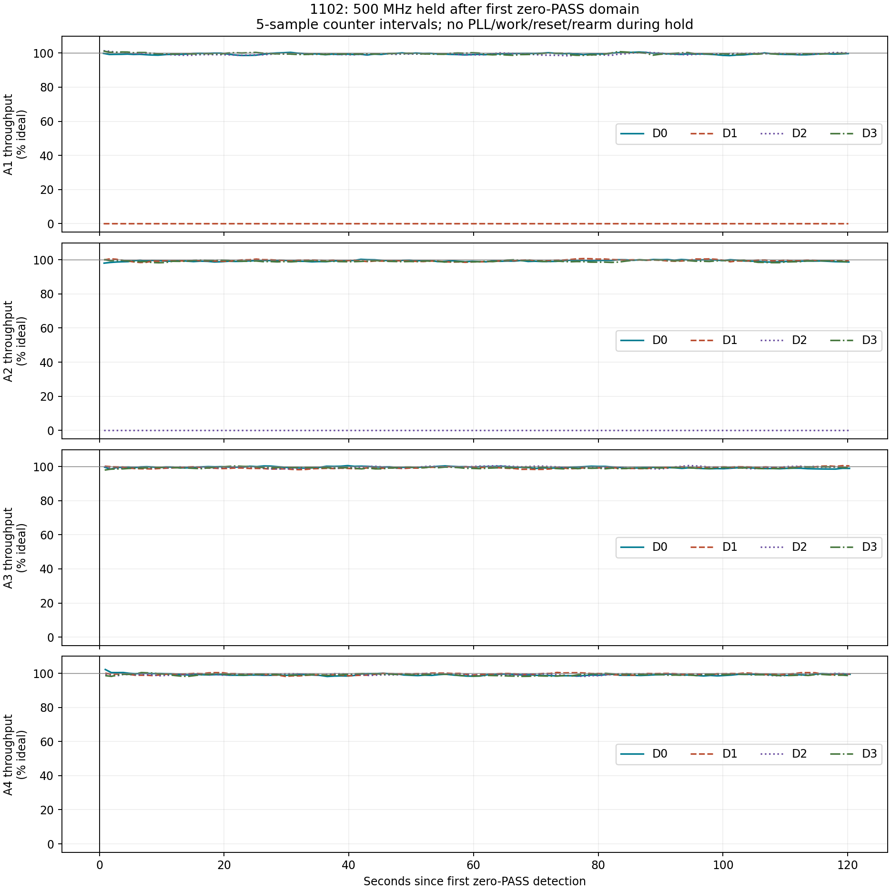
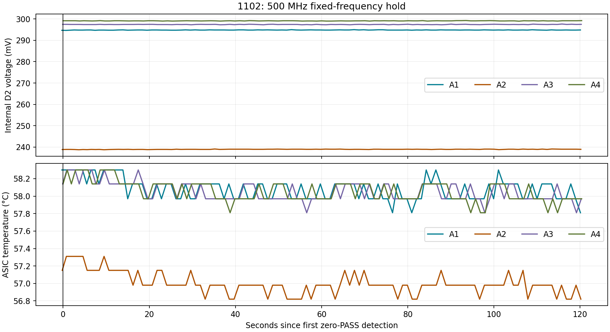

# 1102 first-zero hold at 1160 mV per half

2026-09-05. Completed. User requested testing the higher historical 1160 mV per half before changing work timing.

**1160 mV improved the observed first-failure point by one 25 MHz step, but did not eliminate the failure.** All domains passed at 475 MHz. At 500 MHz, A1 D1 and A2 D2 went to zero PASS on all 39 cores. They remained there throughout a **120.950-second hold**, without any passing results. No higher-frequency step was attempted; this run did not reach 600 MHz.

| Result | Previous 1140 mV/half | This 1160 mV/half |
|---|---:|---:|
| Warm 300 MHz qualification | 99.26% | 99.33% |
| Highest step with all domains passing qualification | 450 MHz | 475 MHz |
| First fully zero-PASS domains | A1 D1 / A2 D2 at 475 MHz | A1 D1 / A2 D2 at 500 MHz |
| Passive hold | 120.930 s, no recovery | 120.950 s, no recovery |
| A2 D2 voltage during failed hold | About 235.5 mV | 238.76–239.11 mV |
| Last-30-second total throughput estimate during failed hold | 2.061 TH/s at 475 MHz | 2.171 TH/s at 500 MHz |

At 475 MHz, this run produced **2354.21 GH/s** versus 2371.2 GH/s ideal; individual domains were 98.59–99.79% of ideal over recorded intervals. At 500 MHz, the other 14 domains sustained 98.95–99.91% over the final 30 seconds. The failed domains continued recording FAIL counts, so zero PASS is not evidence that their clocks stopped. A1 D2 measured about 294.8 mV, but A1's failed domain was D1; this trace does not measure its voltage.

Temperatures during the 500 MHz hold ranged **56.82–58.30°C**, similar to the previous failed hold. Warmup reached its gate at boot time 302.748 s, versus 442.805 s previously. The controller and temperature gate were unchanged, but thermal history and elapsed warmup time necessarily differed. This is one sequential comparison, not a repeated estimate of a precise voltage/frequency threshold.

The 475 MHz scope launch produced lower-half 1.760 V raw / 1.6955 V sliding-20-µs mean, despite healthy subsequent domain throughput. At 500 MHz the lower peak was **1.780 / 1.7085 V**, upper estimate **1.452 / 1.3001 V**, and TPS raw maximum **2.560 V**. No clipped samples. The 20 ms firmware sampler recorded only 2314 mV total. Voltage thresholds remained report-only and did not terminate the test.

First zero-PASS detection was at 456.589 s; the full hold ended at 577.539 s and power-off completed at 577.562 s. No sensor-integrity/temperature stop occurred. Counter epochs remained unchanged throughout the 500 MHz hold, and there were no logged PLL, mining-work or counter-rearm interventions after detection.

**Interpretation:** the higher voltage provides some margin under the current sequence, but restoring the old 1160 mV setting alone does not restore historical 600 MHz operation. It does not resolve whether the remaining cause is immediate work/reset timing, changed PLL tuples, or another initialization difference. The next work-timing comparison should keep 1160 mV and the divider table fixed. No timing or divider change was made in this run.

ASIC power is OFF; final TPS telemetry **46 mV**, fan **70% / 2729 RPM**, scope STOP, **CH1 50 Ω** and CH2 1 MΩ. Saved settings remain 600 MHz / 1160 mV, minimum fan 25%. **The 1160 mV first-zero hold image remains installed and reruns on reset.** Normal source flags are zero; normal firmware was built but not flashed.

`hold-summary.json` contains per-domain windows, `domain-samples.csv` contains counter intervals, `source-difference.patch` records the sole firmware change, and `sha256.json` records artifact hashes.

Only the bench voltage target changed from the previous 1140 mV first-zero hold. `source-difference.patch` verifies the exact one-line difference in `asic_init.c`; MC3, regulator, device configuration and fan controller source snapshots match the previous run byte-for-byte. Current diagnostic PLL divider tuples, burst CFG/EN write and immediate work setup remain in use.

Procedure: warm at 300 MHz with the same fan policy and temperature gate, ramp in 25 MHz steps, then hold for 120 seconds at the first domain with all 39 cores at zero PASS since its launch. No PLL, mining-work, voltage or counter-rearm changes during that hold. Power off after the observation. If no failure occurs, this first-zero mode completes the usual final observation at 600 MHz; it does not add a new prolonged 600 MHz hold. Temperature/PVT conversions and fan control continue throughout.

Voltage and throughput limits remain report-only. Invalid sensor/rail data, communication failures, manual stop and clipped/missing scope data still stop the test. Existing TPS hardware protections are unchanged. 1102 has no midpoint ADC.

Board identity verified: 1102, MAC `10:B4:1D:D5:CA:14`, IP `192.168.30.193`, serial `/dev/cu.usbmodem11434401`. TPS readbacks confirm 1300 kHz, scale 0.125, compensation `13 20 C6 19 C6`, ON_OFF_CONFIG 0x1F. Boot log confirms Vcore ramp reached 1160 mV per half. Saved NVS settings were already 600 MHz / 1160 mV and remain unchanged.

Scope CH1 stays **50 Ω** on TPS output caps, 0.2 V/div. CH2 is GND0−GND, 1 MΩ, 0.5 V/div. Both channels DC, 1×, 20 MHz bandwidth. Each transition captures 700,000 points per channel at 2 MSa/s. CH1−CH2 is an upper-half estimate using different physical probe locations. Initial launch captures do not span the full hold.

Probe and normal builds succeeded; app-only flash was hash-verified. Focused hold and board-policy host tests passed. `probe.bin` is the flashed test image; `normal.bin` was built but not flashed. Source bench flags are restored to zero, while the bench voltage constant records the latest 1160 mV setting. The test image remains installed and reruns on reset.

Logs, source snapshots, scope captures and analysis scripts are saved alongside this note. Qualification-counter throughput is not a pool-hashrate measurement.
